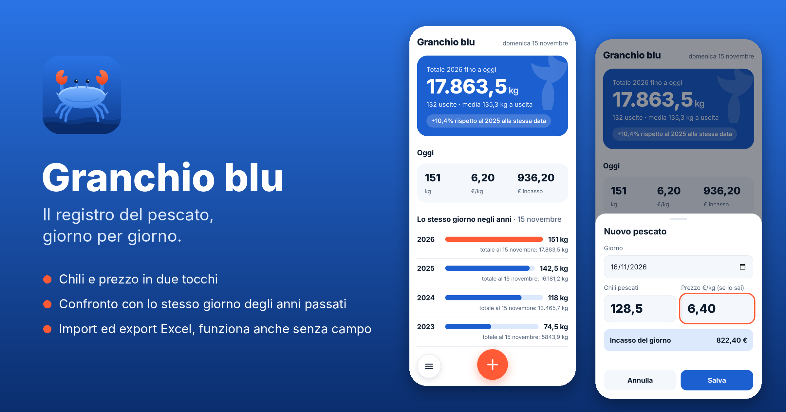
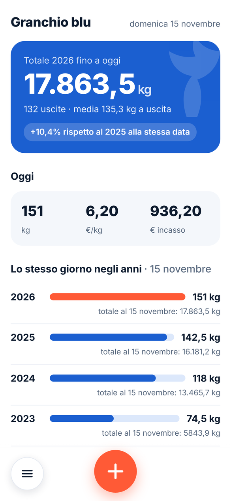
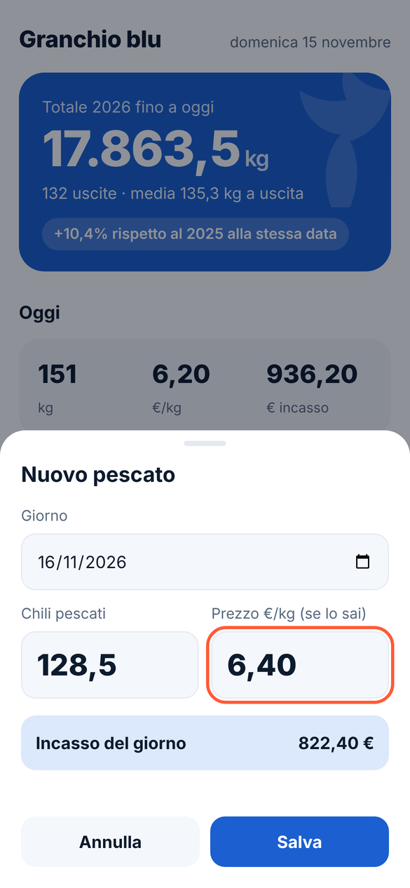
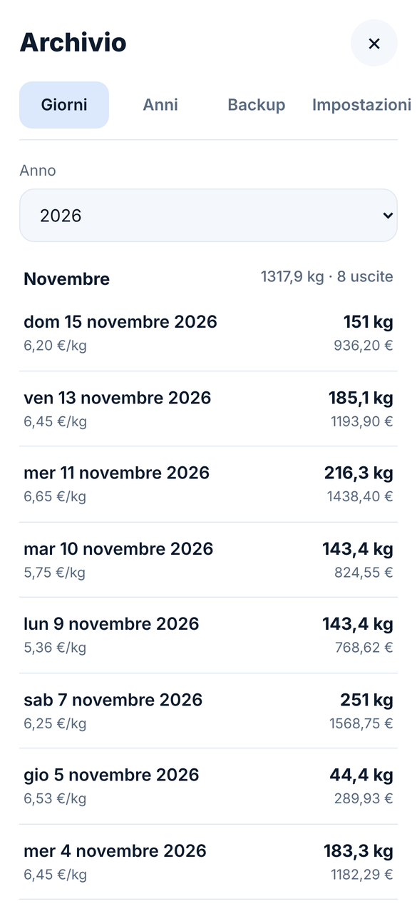
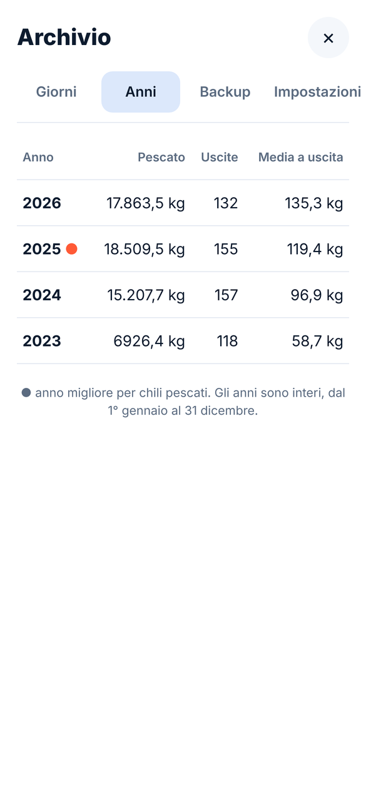
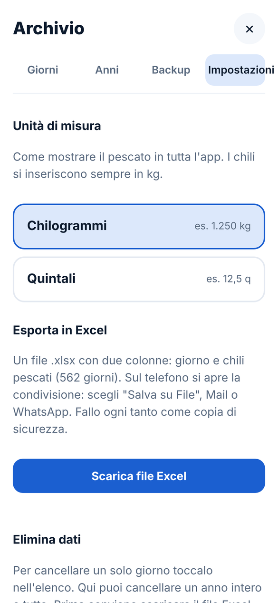

  

# Granchio blu

**Granchio blu** è una web app per tenere il registro del pescato di granchio blu: quanti chili si portano a terra ogni giorno, a che prezzo, e come va la stagione rispetto agli anni passati.

È pensata per chi lavora in barca: si apre dall'icona sulla schermata Home come un'app normale, a tutto schermo, funziona anche senza campo e si usa con un pollice.

## Funzionalità

- **Inserimento rapido** – il pulsante **+** apre un pannello con giorno, chili pescati e prezzo al chilo; l'incasso del giorno viene calcolato da solo.
- **Totale dell'anno** – i chili pescati dal 1° gennaio a oggi, il numero di uscite, la media per uscita e la differenza rispetto all'anno precedente alla stessa data.
- **Lo stesso giorno negli anni** – il pescato di oggi messo a confronto con lo stesso giorno di ogni anno precedente.
- **Archivio** – elenco giorno per giorno diviso per mese e tabella con i totali di ogni anno.
- **Import da Excel** – legge il file dei conferimenti: prende solo le righe di *conferimento* (colonna J, `descrMateriaPrima`) e i chili da `qtaQuota` (colonna S), e somma più conferimenti nello stesso giorno.
- **Export in Excel** – un file `.xlsx` con giorno e chili, da tenere come copia di sicurezza.
- **Chili o quintali** – l'unità di misura si sceglie nelle impostazioni.
- **Cancellazione protetta** – un giorno si cancella con due tocchi dall'elenco; dalle impostazioni si può eliminare un giorno, un mese, un anno intero o tutto l'archivio, solo scrivendo `ELIMINA`.
- **Tema chiaro e scuro** – segue l'impostazione del telefono.

Le novità di ogni aggiornamento sono in [CHANGELOG.md](CHANGELOG.md).

## Schermate

| Home | Nuovo pescato | Giorno per giorno | Anni | Impostazioni |
|:---:|:---:|:---:|:---:|:---:|
|  |  |  |  |  |

Le schermate mostrano dati di esempio.

## Installazione su iPhone

1. Apri l'indirizzo dell'app in **Safari**.
2. Tocca **Condividi** → **Aggiungi alla schermata Home**.
3. Da quel momento apri l'app sempre dall'icona del granchio.

Su Android: apri il link in Chrome → menu ⋮ → **Installa app** (o *Aggiungi a schermata Home*).

## Dove finiscono i dati

I dati restano **sul telefono** di chi usa l'app: non vengono inviati a nessun server e non si perdono chiudendo l'app. Ogni telefono ha il suo archivio.

Per sicurezza conviene scaricare ogni tanto il backup da **menu → Impostazioni → Scarica file Excel**: se il telefono si rompe o si cambia, basta reimportarlo.

> Su iPhone i dati dell'app aperta dall'icona sono separati da quelli della stessa pagina aperta in Safari: usare sempre l'icona.

## Com'è fatta

Nessun framework e nessuna compilazione: è un sito statico.

| File | A cosa serve |
|---|---|
| `index.html` | Tutta l'app: interfaccia, calcoli, import/export |
| `manifest.webmanifest` | Nome, colori e icone per l'installazione sulla schermata Home |
| `sw.js` | Service worker: fa funzionare l'app anche offline |
| `icon-180.png`, `icon-192.png`, `icon-512.png` | Icona del granchio |
| `docs/` | Immagini di questo README |

La lettura e scrittura dei file Excel usa [SheetJS](https://sheetjs.com/), caricata solo quando serve.

## Pubblicazione

Il sito è pubblicato su **Netlify** collegato a questo repository: ogni modifica caricata su `main` viene messa online in automatico. Impostazioni di build: nessun comando di build, cartella di pubblicazione `.`.

---

Fatta per mio padre, pescatore di granchio blu 🦀

